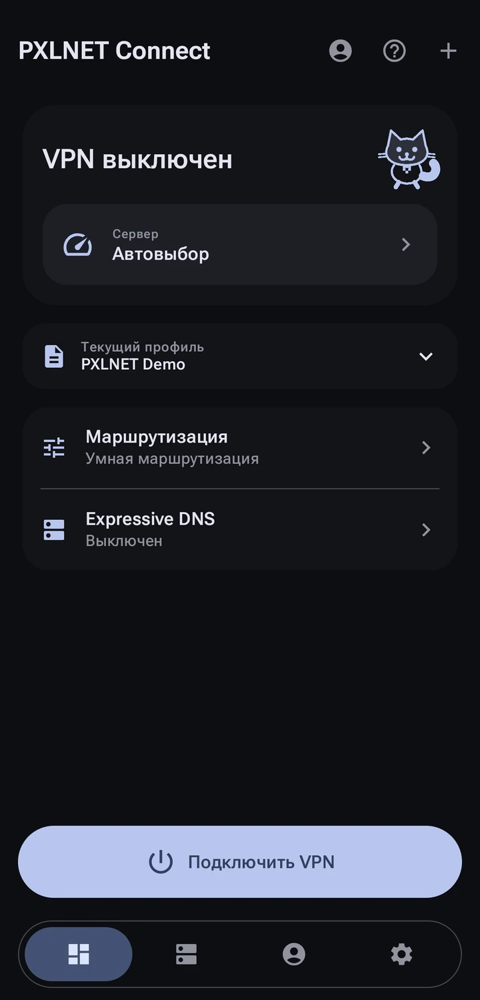
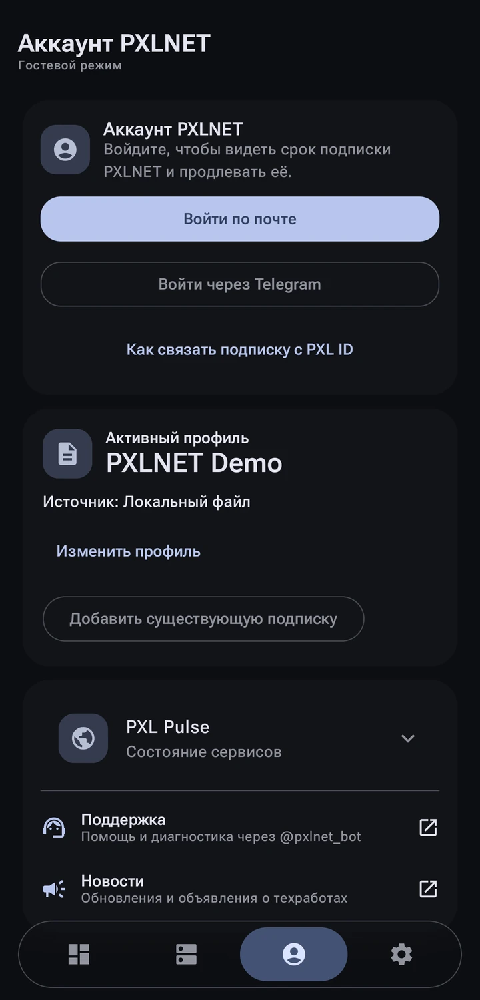
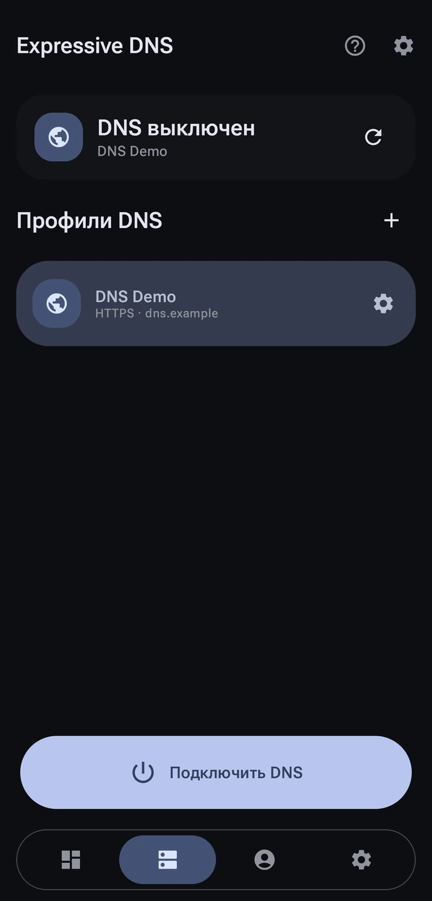

# PXLNET Connect

[Русская версия](README.ru.md) · [Official website](https://kakixc.github.io/PXLNET-Connect/) · [Release notes](https://github.com/kakixc/PXLNET-Connect/releases)

PXLNET Connect is an Android VPN client for the PXLNET service. Sign in with PXL ID to load your linked subscription, or import a server or subscription link without an account.

## Download

| PXLNET Connect 0.7.0 | Choose this build if… |
| --- | --- |
| [ARM64-v8a APK](https://github.com/kakixc/PXLNET-Connect/releases/download/v0.7.0/PXLNET-Connect-0.7.0-arm64-v8a.apk) | Your Android device uses ARM64, as most modern phones do. |
| [Universal APK](https://github.com/kakixc/PXLNET-Connect/releases/download/v0.7.0/PXLNET-Connect-0.7.0-universal.apk) | You are unsure which architecture to choose or need another supported ABI. |

The standard APK requires **Android 7.0 or later**. See the [latest release](https://github.com/kakixc/PXLNET-Connect/releases/latest) for other builds and SHA-256 checksums. If Connect is already installed, check for updates in the app.

## Screenshots

| Console | PXLNET account | Expressive DNS |
| :---: | :---: | :---: |
|  |  |  |

Actual screens from 0.7.0 with demo profiles.

## Features

- **Account and profiles.** Sign in using a one-time email code or Telegram. Use a linked PXL ID subscription, or import a link as a guest. Connect can refresh remote profiles in the background.
- **Connection controls.** Select a server manually or use AUTO. See the selected profile, connection status and transfer rates. PXL Guard can check a failure again and switch to an available server.
- **Smart Routing.** Route all traffic, use Smart Routing rules, or select individual apps for the VPN.
- **Expressive DNS.** Pick your own DNS service, check whether it responds and create profiles with domain or app rules. Use it on its own or alongside the VPN.
- **Appearance.** Choose Classic, Focus or Console in **Settings → Personalization**. New installs open in Console.

## Supported protocols

| Protocol | Engine | Supported options |
| --- | --- | --- |
| VLESS | sing-box | Configurations supported by the bundled sing-box, including TLS and REALITY. |
| VLESS with XHTTP | Xray | TLS or REALITY in the standard Android 7.0+ build. |
| Hysteria2 | sing-box | TLS and optional obfuscation. Links use `hysteria2://` or `hy2://`. |

Connect accepts server links, plain or Base64 subscriptions and native sing-box JSON in advanced mode. The `otherLegacy` source-build flavor targets Android 5–6 and packages libbox without Xray.

## Build and contribute

- [Build from source on Windows](BUILDING.md)
- [Contribution guide](CONTRIBUTING.md)
- [Report a bug or request a feature](https://github.com/kakixc/PXLNET-Connect/issues/new/choose)
- [Report a security issue](SECURITY.md)

## License and credits

PXLNET Connect is based on [sing-box for Android](https://github.com/SagerNet/sing-box-for-android). The project uses **GPLv3 or later**. See the [upstream notice and naming restriction](LICENSE), the [full GPLv3 text](LICENSES/GPL-3.0.txt) and [third-party credits](THIRD_PARTY_NOTICES.md). Connect is an independent project.

[News on Telegram](https://t.me/pxlnet) · [PXLNET support](https://t.me/pxlnet_bot)
