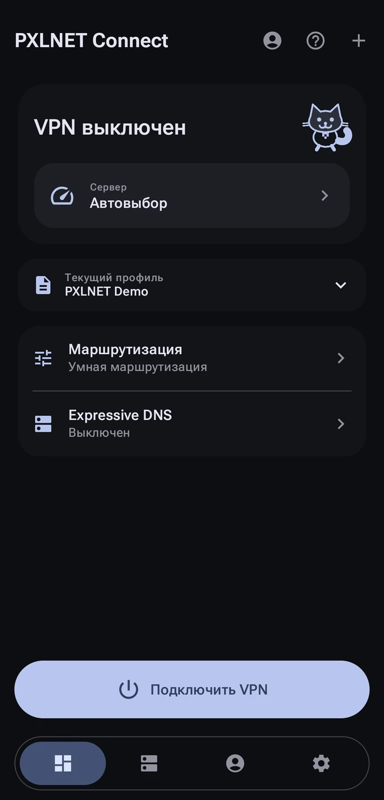
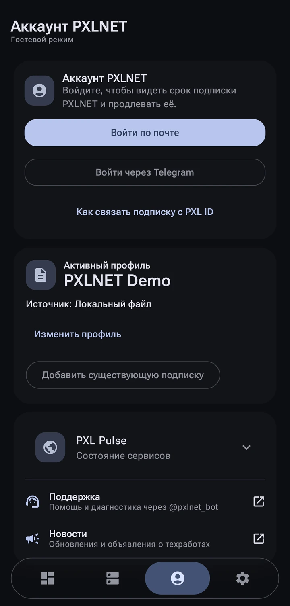
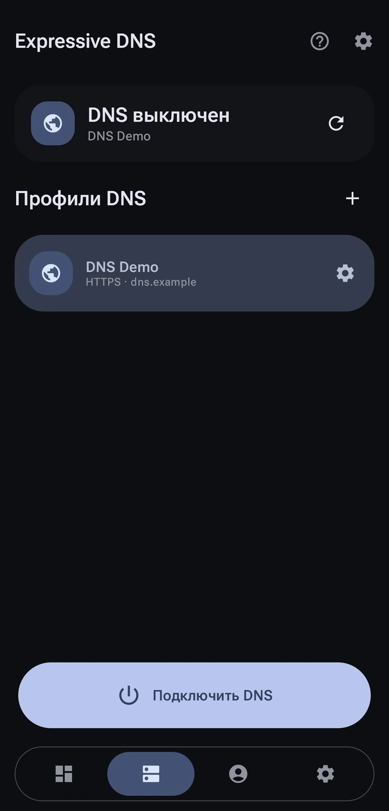

# PXLNET Connect

[English](README.md) · [Официальный сайт](https://kakixc.github.io/PXLNET-Connect/) · [История релизов](https://github.com/kakixc/PXLNET-Connect/releases)

PXLNET Connect — VPN-клиент для Android и сервиса PXLNET. Войдите в PXL ID, чтобы загрузить привязанную подписку, или добавьте сервер или подписку по ссылке без регистрации в приложении.

## Скачать

| PXLNET Connect 0.7.0 | Когда выбирать |
| --- | --- |
| [APK для ARM64-v8a](https://github.com/kakixc/PXLNET-Connect/releases/download/v0.7.0/PXLNET-Connect-0.7.0-arm64-v8a.apk) | Для большинства современных Android-смартфонов. |
| [Универсальный APK](https://github.com/kakixc/PXLNET-Connect/releases/download/v0.7.0/PXLNET-Connect-0.7.0-universal.apk) | Если не знаете архитектуру устройства или нужна другая поддерживаемая архитектура. |

Для стандартного APK нужен **Android 7.0 или новее**. Другие сборки и контрольные суммы SHA-256 на [странице последнего релиза](https://github.com/kakixc/PXLNET-Connect/releases/latest). Если Connect уже установлен, проверьте обновление в приложении.

## Скриншоты

| Пульт | Аккаунт PXLNET | Expressive DNS |
| :---: | :---: | :---: |
|  |  |  |

Реальные экраны 0.7.0 с демонстрационными профилями.

## Возможности

- **Аккаунт и профили.** Войдите по одноразовому коду из письма или через Telegram. Можно загрузить привязанную подписку PXL ID или добавить ссылку в гостевом режиме. Удалённые профили могут обновляться в фоне.
- **Подключение.** Выберите сервер вручную или включите AUTO. На главном экране видны профиль, состояние VPN и скорость. При сбое PXL Guard может перепроверить соединение и переключиться на доступный сервер.
- **Умная маршрутизация.** Пропускайте через VPN весь трафик, используйте правила Smart Routing или выберите нужные приложения.
- **Expressive DNS.** Выберите, какой DNS-сервис будет находить адреса сайтов, проверьте его доступность и задайте правила для доменов или приложений. DNS работает отдельно или вместе с VPN.
- **Оформление.** В **Настройки → Персонализация** доступны «Классика», «Фокус» и «Пульт». Новая установка открывается в «Пульте».

## Поддерживаемые протоколы

| Протокол | Движок | Возможности |
| --- | --- | --- |
| VLESS | sing-box | Конфигурации, которые поддерживает встроенный sing-box, включая TLS и REALITY. |
| VLESS с XHTTP | Xray | TLS или REALITY в стандартной сборке для Android 7.0 и новее. |
| Hysteria2 | sing-box | TLS и опциональная обфускация. Ссылки `hysteria2://` и `hy2://`. |

Connect принимает ссылки на отдельные серверы, обычные и Base64-подписки. В расширенном режиме можно импортировать нативный JSON sing-box. Вариант `otherLegacy` для самостоятельной сборки под Android 5–6 включает libbox без Xray.

## Сборка и участие

- [Сборка из исходников на Windows](BUILDING.md)
- [Как внести вклад](CONTRIBUTING.md)
- [Сообщить об ошибке или предложить функцию](https://github.com/kakixc/PXLNET-Connect/issues/new/choose)
- [Как сообщить об уязвимости](SECURITY.md)

## Лицензия и авторство

PXLNET Connect основан на [sing-box for Android](https://github.com/SagerNet/sing-box-for-android) и распространяется по **GPLv3 или новее**. См. [исходное уведомление и ограничение использования имени](LICENSE), [полный текст GPLv3](LICENSES/GPL-3.0.txt) и [сведения о сторонних компонентах](THIRD_PARTY_NOTICES.md). Connect — самостоятельный проект.

[Новости в Telegram](https://t.me/pxlnet) · [Поддержка PXLNET](https://t.me/pxlnet_bot)
